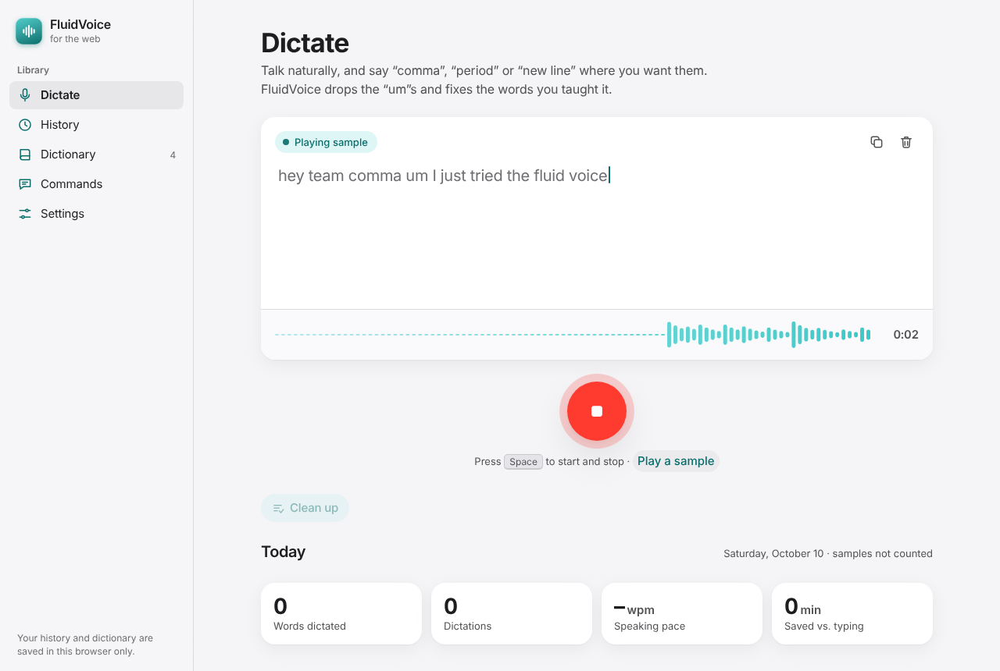
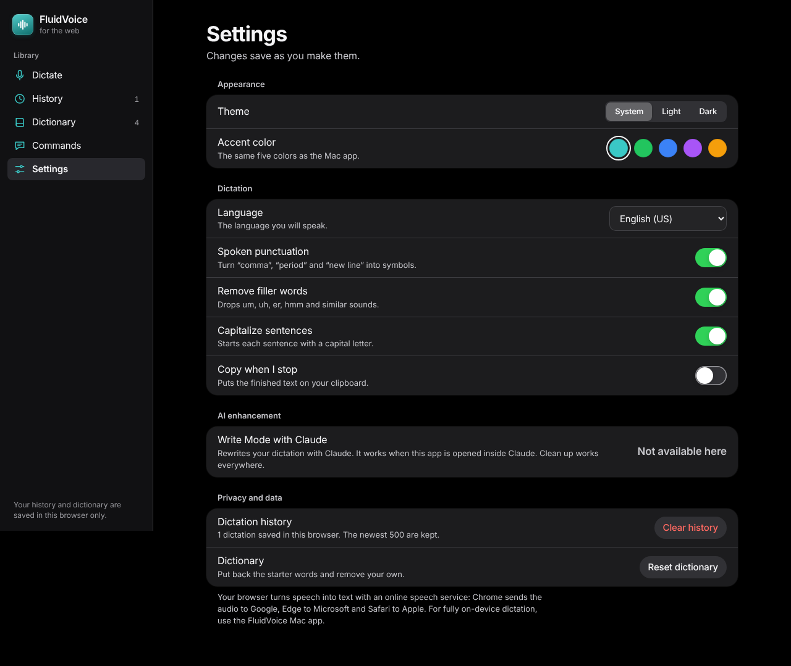
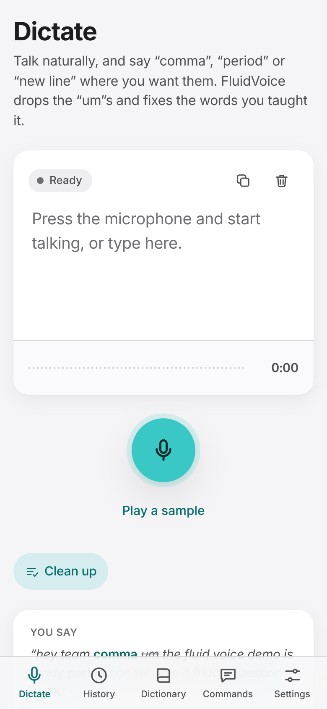
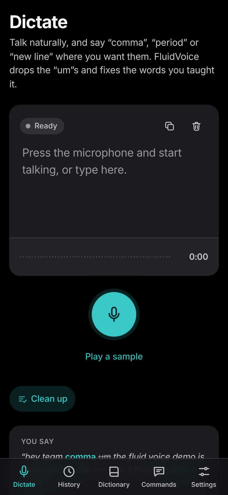

# FluidVoice Web: design and quality audit

**Date:** October 10, 2026 · **File checked:** `web/index.html`

The audit compares the web app with Apple's Human Interface Guidelines (HIG) and standard web accessibility rules (WCAG 2.1 AA). It ran in headless Chromium at desktop width (1280px) and phone width (390px), in light and dark mode. Before publishing, a second review used four independent reviewers, each checking one area, and a separate checker tried to disprove every problem they reported. Re-run the automated part with `tests/audit.js`.

## Result

| Check | Result |
| --- | --- |
| Text formatting tests (punctuation, fillers, dictionary, capitals, clean up, word count, Portuguese, German, Chinese, Hindi) | 35 of 35 pass |
| Fake-microphone test: dictate, stop, start again quickly, stop | Passes: one recognizer at a time, microphone released at the end |
| Main flows: sample dictation, save to history, clean up, undo, add a dictionary word, form errors, theme, accent, Space shortcut | All work |
| JavaScript errors in the console | None |
| Page scrolls sideways | Never, on any screen |
| Accessibility (axe-core 4.10, all 5 screens at desktop and phone width in light mode, and at phone width in dark mode) | 0 violations |
| Touch targets of at least 44 × 44pt on touch screens (phones and iPads) | All except the native-size switches and segmented control (see below) |

## What Apple's guidelines ask for, and how the app meets them

| HIG principle | How the app meets it |
| --- | --- |
| **Clarity**: system font, clear hierarchy | Uses San Francisco (the system font) on Apple devices and Segoe UI on Windows. Text sizes follow Apple's text styles: Large Title 34, Title 3 20, Body 17, Footnote 13. Stats use SF Rounded, as Apple's Fitness and Screen Time do. |
| **Deference**: content first | The transcript is the largest element on screen. Colors are neutral, and the accent is used only for the main action and links. |
| **Depth**: materials | The sidebar and phone tab bar use a translucent, blurred material, like macOS sidebars and the iOS tab bar. |
| **Familiar navigation** | macOS-style sidebar on desktop. On phones it becomes an iOS tab bar fixed to the bottom, clear of the home indicator, and clear of the notch in landscape. |
| **Native-looking controls** | iOS-style switches, segmented control, grouped settings lists, pill buttons and a Voice Memos-style live waveform. |
| **Dark Mode** | A full dark palette using Apple's dark system colors (#000 base, #1C1C1E surfaces). It follows the system setting, and you can override it in Settings. The browser's toolbar color follows your choice too. |
| **Color contrast** | All text meets 4.5:1 in both themes and with all five accent colors. Focus rings, switches and the selected color swatch meet the 3:1 rule for controls. |
| **Touch targets of 44 × 44pt** | Every button, icon button, input and color swatch is at least 44pt on touch screens, phone or iPad. Text fields use 16px text so iPhones don't zoom in when you tap them. |
| **Reduce Motion** | When the system's Reduce Motion setting is on, animations and transitions are switched off and the ring around the record button stops pulsing. The waveform still shows your voice level, because it is live feedback. |
| **Feedback** | A status pill (Waiting for microphone permission, Listening, Playing sample, Thinking…), a live waveform, a timer, and toasts that confirm actions ("Copied", "Saved 33 words to History"). |
| **Forgiveness** | Clear, Clean up and Write Mode can be undone, and Undo turns into Redo. Deleting all history asks for confirmation on the page first. |
| **Plain language** | Errors say what went wrong and how to fix it, for example "Allow microphone access for this page in your browser's address bar, then press the microphone again." |
| **Keyboard and VoiceOver** | Every control can be reached and used with the keyboard, focus is always visible (including the transcript box), and icon buttons have spoken labels. The color swatches work with arrow keys like a native radio group. While you dictate, screen readers hear only the newly finished words, not the whole page again. |

## Problems fixed in the first pass

1. **Low-contrast text on two buttons.** "Clean up" measured 4.26:1 and "Clear history" 4.32:1, below the 4.5:1 minimum. The text colors were darkened for every accent.
2. **White text on blue and purple buttons** measured 3.7:1 and 4.0:1. Those accents now use dark text.
3. **Buttons too small to tap on phones.** 25 controls were 28 to 40px tall. They are now at least 44px.
4. **Headings out of order** on the Commands page. Fixed for screen readers.
5. **"Listening" could stay on forever** in browsers that never start speech recognition. A timer now stops it and explains what to do.
6. **Clean up missed two cases**: a lowercase "i", and no space in "fine.new".
7. **The sidebar stopped halfway down** on long pages.
8. **"Press Space" hint shown on phones**, which have no Space key.
9. **Cards stretched over empty space** on the Commands page.

## Problems fixed after the second review

The second review confirmed 57 reports, about 45 separate problems once duplicates are merged. All are fixed. The most important:

- **Real words were deleted in other languages.** The "um/uh/er" list is English, but it also ran for Portuguese ("um" means "a"), German ("er", "um"), Dutch and Swedish. Filler removal now runs only for English. It also keeps "ER" (emergency room) and "5 mm".
- **The microphone could stay on after Stop.** Stopping and starting again within 1.5 seconds left an old recognizer running, while the screen said "Ready". Old sessions are now shut down completely and can't add text to new ones. Holding Space no longer toggles dictation on and off.
- **First-time visitors got an error while answering the permission prompt.** The app now waits up to 30 seconds and shows "Waiting for microphone permission…".
- **The GitHub Pages steps in the README were wrong.** GitHub Pages can't publish from a `web` folder. The app is now published from its own `gh-pages` branch.
- **Clean up broke links and email addresses**, for example by adding spaces inside them. They're now left untouched.
- **Undo could throw away a newer dictation.** Undo is cleared whenever the text changes in another way.
- **"Copy when I stop" never worked in Safari.** The copy now starts while your Stop click still counts.
- **Old Safari versions (iOS 15) couldn't run the app at all** because of a newer regular-expression feature. It's gone.
- **Dictionary words didn't work in Chinese or Japanese sentences**, and word counts were wrong in Chinese, Japanese and Hindi.
- **Continuing a dictation lost line breaks** and put a space before punctuation such as a comma.
- **Smaller fixes:** the default language now matches browsers that report only "fr" or "de". Capitals no longer break "iPhone", "macOS" or "i.e.". Repeated closing brackets are kept. Long dictations no longer stop silently after 50 pauses. The History chart is readable on phones and screen readers read its numbers. Long History entries have a "Show more" button. Keyboard focus no longer gets lost after deleting something. The privacy note now says Edge sends audio to Microsoft, not Google. There is a home-screen icon for iPhone. Older browsers without `color-mix()` get readable colors. Help messages fit iPhone users and Brave/Opera users. Several sentences in the app and these documents were corrected so they don't overpromise.

Five reports were rejected by the checker as not affecting real users, for example a crash that needs hand-edited browser storage.

## Accepted as is

- **Switches are 51 × 31pt and the segmented control is 40pt tall.** These are Apple's own native sizes. In Settings, tapping anywhere on a switch's row toggles it, so the real tap area is the full row.

## Not covered by this audit

- **Real microphone dictation.** The test machine has no microphone, and Chromium's speech service was blocked on its network. Live dictation was tested with a fake microphone that behaves like Chrome's, plus the sample dictation. Try it once in Chrome and once in Safari on your own device.
- **Safari and iOS.** Only Chromium was automated. The code avoids features older Safari can't run, but test it on an iPhone before sharing widely.
- **Write Mode with Claude** only runs when the page is opened inside Claude, so it couldn't run in the test browser. Outside Claude it hides itself, and Settings says it's "Not available here".

## Screenshots

| Desktop, light | Dictating a sample | Settings, dark |
| --- | --- | --- |
|  |  |  |

| Phone, light | Phone, dark |
| --- | --- |
|  |  |
