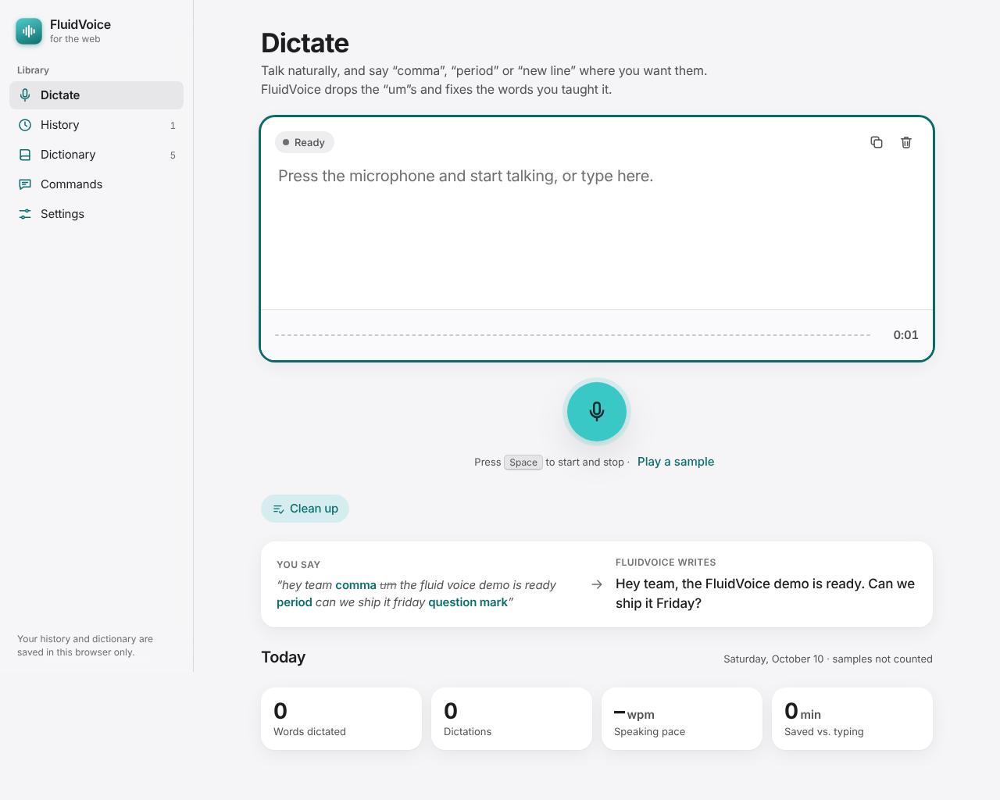

# FluidVoice for the web

A browser version of FluidVoice: talk, and it writes clean text. It is one file, `index.html`, with no build step and nothing to install.

**Open it:** <https://laminedo.github.io/FluidVoice/>

## What it does

- **Dictate**: press the microphone (or <kbd>Space</kbd>) and talk. Words appear live, in gray until the browser is sure of them.
- **Spoken punctuation**: say "comma", "period", "question mark", "new line" and more. The full list is in the **Commands** tab.
- **Filler words removed** (English): um, uh, er, hmm and similar sounds are dropped, using the same list as the Mac app.
- **Dictionary**: teach it words it gets wrong, for example "fluid voice" becomes "FluidVoice".
- **Clean up**: fixes spacing, capitals and fillers in text you already have, and leaves links and email addresses alone.
- **Write Mode** (only when opened inside Claude): rewrites your text as polished prose, an email, bullet points or a shorter version.
- **History and Today stats**: words dictated, speaking pace, and time saved compared with typing.
- **Light and dark mode**, and the Mac app's five accent colors.

## How to open it

**Easiest:** go to <https://laminedo.github.io/FluidVoice/> in **Chrome**, **Edge** or **Safari**. When the browser asks for the microphone, choose **Allow**. On iPhone and iPad, use **Safari**.

**From the file on your computer:** right-click `web/index.html` and choose **Open With → Chrome** (or Safari). If the microphone doesn't work that way, run a tiny local web server:

- **Mac:** in Finder, right-click the `web` folder and choose **Services → New Terminal at Folder**. Type `python3 -m http.server 8000` and press Return. If your Mac offers to install developer tools, accept. Then go to <http://localhost:8000>.
- **Windows with Python:** open the `web` folder, type `cmd` in the address bar, press Enter, then run `py -m http.server 8000` and go to <http://localhost:8000>.

## How it's published

GitHub Pages serves the site from the **`gh-pages`** branch, which holds a copy of this `web` folder. GitHub Pages can only publish a whole branch or a `docs` folder, not a folder called `web`, so the app gets its own branch.

- **One-time setup:** in the repository, open **Settings → Pages**. Under **Build and deployment**, set **Source** to **Deploy from a branch**, choose **`gh-pages`** and **`/ (root)`**, and press **Save**. After a minute or two the site is live.
- **After you change the app:** run `git subtree push --prefix web origin gh-pages` from the repository folder, or ask Claude to republish it.

## Good to know

- Firefox can't turn speech into text yet. The app tells you, and you can still type, use Clean up and play the sample.
- Your browser sends your audio to its online speech service: Google in Chrome, Microsoft in Edge, Apple in Safari. The native Mac app runs fully on your device.
- History, dictionary and settings are saved in your browser (`localStorage`). They don't sync between browsers or devices. The newest 500 dictations are kept.

## Checking the app

`tests/audit.js` opens the app in a headless browser. It checks the text formatting, a fake-microphone dictation, the main buttons, accessibility and the phone layout. See [AUDIT.md](AUDIT.md) for the latest results.
